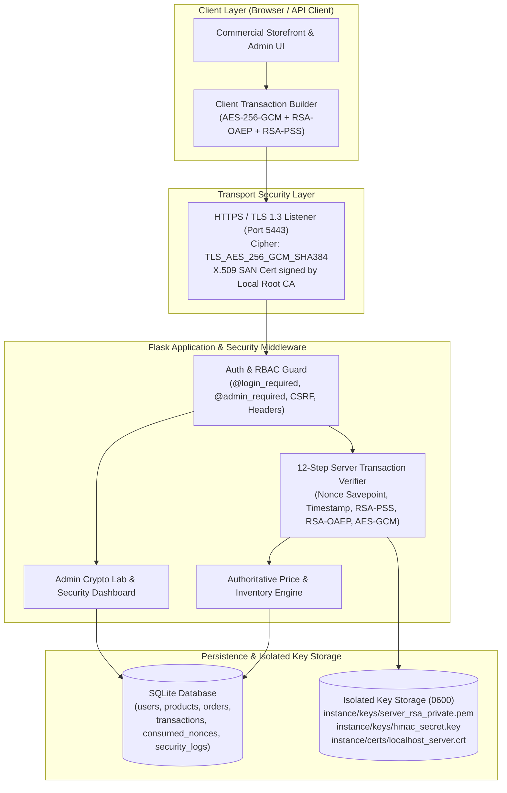
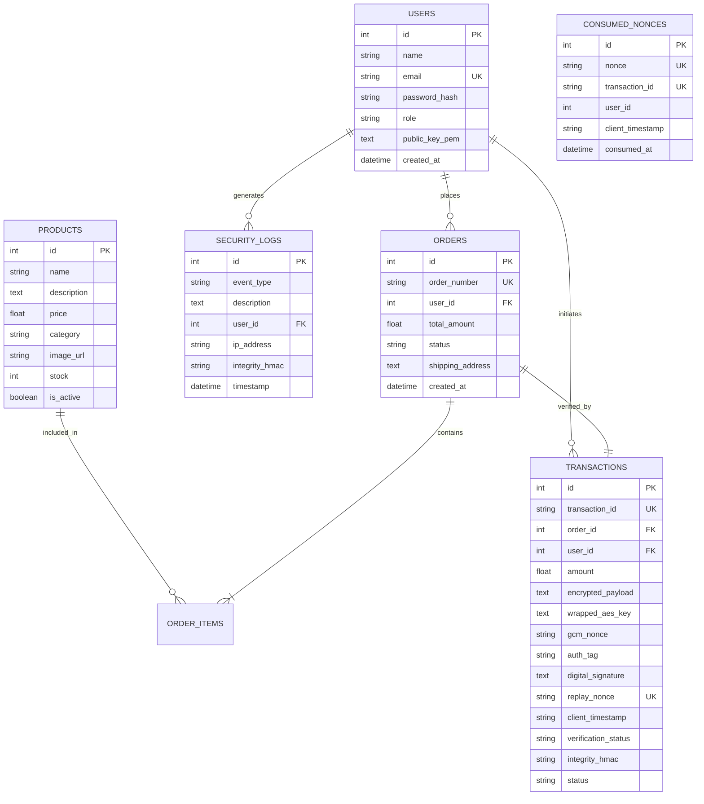
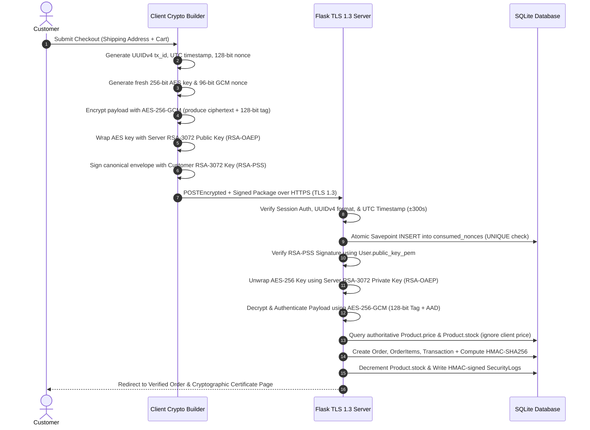

# FINAL PROJECT DOCUMENTATION
## SECURE E-COMMERCE TRANSACTION SYSTEM USING HYBRID CRYPTOGRAPHY AND TLS

---

## 1. Project Title

**Secure E-Commerce Transaction System Using Hybrid Cryptography and TLS 1.3** (`SecureShop`)

---

## 2. Abstract

Modern e-commerce applications handle sensitive customer credentials, financial order totals, and personal shipping data across untrusted networks. While Transport Layer Security (TLS) protects data in transit between endpoints, relying solely on transport-layer encryption leaves transaction payloads vulnerable to application-level parameter tampering, replay attacks, repudiation, and database audit log manipulation. This project presents **SecureShop**, a full-stack secure e-commerce transaction system engineered in Python (Flask) that combines **TLS 1.3** transport encryption with an application-layer **Hybrid Cryptographic Transaction Pipeline**. Every checkout transaction generates an ephemeral 256-bit symmetric session key to encrypt the order payload using **AES-256-GCM** (Authenticated Encryption with Associated Data), wraps the session key using the server's **3072-bit RSA-OAEP** public key, signs the canonical transaction envelope using the customer's registered **3072-bit RSA-PSS** keypair, and enforces atomic database **nonce/timestamp replay protection**. User credentials are protected via **PBKDF2-HMAC-SHA256** (`260,000` iterations with 128-bit salts), while stored transaction records and security audit logs are authenticated using **HMAC-SHA256**. An automated verification suite of **85 tests** validates all functional workflows, cryptographic algorithms, and 18 controlled attack simulations with a 100% pass rate.

---

## 3. Introduction

Electronic commerce platforms are prime targets for cyberattacks ranging from Man-in-the-Middle (MITM) interception and replay attacks to client-side price manipulation, privilege escalation, and audit trail tampering. Standard web applications often treat security as an external perimeter concern rather than an intrinsic property of each transaction record.

**SecureShop** bridges this gap by integrating modern applied cryptography directly into the e-commerce order lifecycle. In addition to providing a complete commercial storefront—featuring product search, category filtering, cart management, customer order tracking, and enterprise administration—the system constructs a self-contained cryptographic proof for every order placed.

---

## 4. Problem Statement

Conventional academic and prototype e-commerce systems suffer from five critical security deficiencies:
1. **Lack of Payload Confidentiality & Integrity Beyond TLS Termination:** Once HTTPS traffic is terminated, order payloads lack cryptographic binding, allowing modified ciphertexts or manipulated prices to be processed if not re-verified.
2. **Vulnerability to Replay Attacks:** Captured checkout requests can be re-transmitted to create duplicate orders unless strict, atomic nonce consumption and narrow timestamp windows are enforced.
3. **Lack of Transaction Non-Repudiation:** Without digital signatures verified against per-user public keys, a system cannot cryptographically prove which authenticated user authorized a transaction envelope.
4. **Tamper-Prone Security Audit Logs:** If an attacker gains write access to the database, plain audit logs can be altered or deleted undetected without keyed message authentication codes (HMAC).
5. **Weak Credential & Access Control Boundaries:** Inadequate password key derivation or missing Role-Based Access Control (RBAC) and Insecure Direct Object Reference (IDOR) checks expose administrative and other customers' data.

---

## 5. Objectives

1. Design and implement a complete, responsive e-commerce web application supporting Guest, Customer, and Admin roles.
2. Implement **AES-256-GCM** authenticated encryption with fresh 256-bit keys, 96-bit nonces, and 128-bit authentication tags for every transaction.
3. Implement **3072-bit RSA-OAEP (SHA-256, MGF1-SHA256)** asymmetric key wrapping to securely exchange ephemeral AES session keys.
4. Implement **3072-bit RSA-PSS (SHA-256, MGF1-SHA256)** digital signatures over canonical transaction envelopes to ensure authenticity and non-repudiation.
5. Implement **PBKDF2-HMAC-SHA256** (`260,000` iterations, 128-bit random salt) for password hashing and **HMAC-SHA256** for database record and security log integrity.
6. Implement atomic **replay protection** using 128-bit cryptographic nonces (`ConsumedNonce`), UUIDv4 transaction IDs, and `±300s` UTC timestamp validation.
7. Configure **TLS 1.3 / HTTPS** with a local X.509 Root CA and SAN server certificate, and provide interactive **Security & Cryptography Demonstration Dashboards**.

---

## 6. Technology Stack

| Layer | Technology / Library | Purpose |
|-------|----------------------|---------|
| **Backend Framework** | Python 3.12, Flask 3.1.0 | Routing, request handling, blueprints, security middleware |
| **Database & ORM** | SQLite 3, Flask-SQLAlchemy 3.1.1 | Relational persistence, atomic savepoints (`ConsumedNonce`) |
| **Authentication & CSRF** | Flask-Login 0.6.3, Flask-WTF 1.2.2 | Session management (`HttpOnly`, `SameSite=Lax`), CSRF protection |
| **Cryptography Engine** | `cryptography` 44.0.0 (OpenSSL backend) | `AESGCM`, `RSA-3072`, `OAEP`, `PSS`, `PBKDF2HMAC`, `HMAC`, `x509` |
| **Transport Security** | Python `ssl` (`TLSVersion.TLSv1_3`) | Strict TLS 1.3 socket & `MemoryBIO` handshake enforcement |
| **Frontend UI/UX** | HTML5, Jinja2, Bootstrap 5.3, Custom CSS/SVG | Responsive commercial storefront & enterprise admin console |
| **Testing & Packet Analysis** | `pytest`, `unittest`, Wireshark | 85 automated unit/integration/attack tests & TLS packet inspection |

---

## 7. System Architecture

---

## 8. Cryptographic Algorithms

### 8.1 AES-256-GCM (`services/crypto/aes_encryption.py`)
- **Key Generation:** $K \leftarrow \text{CSPRNG}(32\text{ bytes})$ (`256 bits`).
- **Nonce Generation:** $N \leftarrow \text{CSPRNG}(12\text{ bytes})$ (`96 bits`), checked against runtime `_USED_KEY_NONCE_PAIRS` to prevent $(K, N)$ reuse.
- **Associated Data (AAD):** $A = \text{UTF8}(\text{tx\_id} \parallel \text{":"} \parallel \text{user\_id} \parallel \text{":"} \parallel \text{timestamp} \parallel \text{":"} \parallel \text{nonce})$.
- **Encryption:** $(C, T) = \text{AES-256-GCM-Enc}(K, N, P, A)$ where $|T| = 128\text{ bits}$ (`16 bytes`).

### 8.2 RSA-OAEP Key Wrapping (`services/crypto/rsa_encryption.py`)
- **Key Size:** `3072 bits`, public exponent $e = 65537$.
- **Padding:** OAEP with `SHA-256` hash and `MGF1(SHA-256)`.
- **Operation:** Wraps the 32-byte AES session key $K$ into a 384-byte ciphertext $W = \text{RSA-OAEP-Enc}(\text{PK}_{\text{server}}, K)$.

### 8.3 RSA-PSS Digital Signatures (`services/crypto/digital_signature.py`)
- **Key Size:** `3072 bits` per user (`User.public_key_pem`).
- **Padding:** Probabilistic Signature Scheme (`PSS`) with `SHA-256`, `MGF1(SHA-256)`, and `PSS.MAX_LENGTH` salt.
- **Signed Canonical Envelope:** Deterministic JSON serialization (`sort_keys=True, separators=(',', ':')`) of `transaction_id`, `user_id`, `timestamp`, `nonce`, `ciphertext_b64`, `gcm_nonce_b64`, `auth_tag_b64`, and `wrapped_key_b64`.

### 8.4 PBKDF2-HMAC-SHA256 (`services/crypto/integrity.py`)
- **Salt:** 16-byte (`128-bit`) random salt per password.
- **Iterations:** `260,000` iterations of `HMAC-SHA256`, producing a 32-byte (`256-bit`) derived key verified in constant time.

### 8.5 HMAC-SHA256 (`services/crypto/integrity.py`)
- **Key:** Dedicated 256-bit secret stored in `instance/keys/hmac_secret.key`.
- **Target Records:** Computed over canonical fields of every `SecurityLog` and `Transaction` row to detect unauthorized SQLite modifications.

---

## 9. Database Design

---

## 10. Secure Transaction Workflow

---

## 11. Implementation Details

- **`services/crypto/key_storage.py`:** Manages filesystem creation and `0600` permission hardening for `instance/keys/server_rsa_private.pem`, `instance/keys/server_rsa_public.pem`, `instance/keys/hmac_secret.key`, `instance/client_keys/`, and `instance/certs/`.
- **`services/crypto/transaction_security.py`:** Implements `build_client_transaction_package()` (Steps 3–10 of client flow), `verify_and_process_transaction_package()` (12-step server verification and authoritative DB order creation), and TLS 1.3 certificate provisioning (`ensure_local_tls_certificates()`).
- **`routes/admin.py`:** Implements the Store Administration CRUD endpoints, the live **Security Dashboard** (`/admin/security-dashboard`), and the interactive **Cryptography Demonstration Lab** (`/admin/crypto-demo`).

---

## 12. Security Mechanisms

1. **Confidentiality:** TLS 1.3 (`TLS_AES_256_GCM_SHA384`) in transit + AES-256-GCM payload encryption + RSA-OAEP-3072 session key wrapping.
2. **Data Integrity:** 128-bit AES-GCM authentication tags + AAD metadata binding + HMAC-SHA256 on database records.
3. **Authentication & Non-Repudiation:** PBKDF2-HMAC-SHA256 (`260,000` iterations) user authentication + RSA-PSS-3072 digital signatures verified with registered per-user public keys.
4. **Replay Prevention:** 128-bit random nonces atomically inserted via nested SQLite savepoints into `consumed_nonces` (`UNIQUE` constraints on both `nonce` and `transaction_id`) + `±300s` UTC timestamp tolerance.
5. **Web Application Hardening:** `Flask-WTF` CSRF tokens, parameterized SQLAlchemy queries (SQLi prevention), Jinja2 auto-escaping (XSS prevention), safe relative redirect validation (Open Redirect prevention), and `nosniff` / `SAMEORIGIN` / `HSTS` HTTP headers.

---

## 13. Testing Methodology

Testing is divided into four automated tiers executed via `pytest`:
1. **Tier 1 — Core Functional & RBAC Suite (`tests/test_app.py`, 35 tests):** Registration, login, password hashing, catalogue, search, cart, checkout, admin CRUD, and guest/customer/admin access control.
2. **Tier 2 — Cryptographic Primitive & Flow Suite (`tests/test_crypto.py`, 22 tests):** Positive and negative unit tests for AES-256-GCM, RSA-OAEP-3072, RSA-PSS-3072, PBKDF2-HMAC-SHA256, HMAC-SHA256, replay protection, price recomputation, and TLS 1.3 handshakes.
3. **Tier 3 — Official CNS Test Cases (`tests/test_audit.py::TestOfficialCNSTestCases`, 10 tests):** `T01` through `T10`.
4. **Tier 4 — Controlled Attack Simulations & Admin Telemetry (`tests/test_audit.py`, 18 tests):** 15 controlled attacks + Admin CRUD + Crypto Lab buttons + Phase 3 edge cases & Security Dashboard verification.

---

## 14. Test Results

All **85 automated tests** executed and passed (`0` failures) in `21.28 seconds`:

| Suite | File | Passed | Failed |
|-------|------|--------|--------|
| Phase 1 Functional & RBAC Tests | `tests/test_app.py` | 35 | 0 |
| Phase 2 Cryptographic Unit & Flow Tests | `tests/test_crypto.py` | 22 | 0 |
| Official CNS (`T01`–`T10`) & 18 Attack Simulations | `tests/test_audit.py` | 28 | 0 |
| **Total** | **`test_results.txt`** | **85** | **0** |

---

## 15. Wireshark Demonstration

Full instructions are provided in [WIRESHARK_GUIDE.md](file:///c:/Users/Manish/Downloads/CNS%20Project/WIRESHARK_GUIDE.md). When capturing on the `Adapter for loopback traffic capture` with display filter `tcp.port == 5443`:
- Wireshark captures the `Client Hello` and `Server Hello` negotiating `TLSv1.3 (0x0304)` and cipher suite `TLS_AES_256_GCM_SHA384`.
- Subsequent checkout packets appear exclusively as `TLSv1.3 Record Layer: Application Data Protocol: http-over-tls` containing high-entropy encrypted bytes.
- Because TLS 1.3 uses ephemeral ECDHE key exchange (Forward Secrecy) and the inner payload is additionally encrypted with AES-256-GCM and RSA-OAEP-3072, no plaintext product names, addresses, or session tokens can be read from the packet capture.

---

## 16. Limitations

1. **Browser Client Key Custody:** For seamless browser checkout without requiring users to install a PKCS#11 hardware token or browser extension, client RSA-3072 private keys are managed in an isolated `0600` server directory (`instance/client_keys/`) while also supporting externally signed packages via `POST /api/transactions/secure-checkout`.
2. **Local Development Root CA:** The HTTPS server on port `5443` uses a locally generated Root CA (`instance/certs/local_root_ca.crt`), which requires trust store import to suppress browser self-signed warnings.
3. **Single-Node SQLite Storage:** Designed for academic demonstration and local benchmarking rather than distributed multi-node cluster deployment.

---

## 17. Conclusion

The **Secure E-Commerce Transaction System Using Hybrid Cryptography and TLS** successfully demonstrates how modern symmetric encryption (`AES-256-GCM`), asymmetric key encapsulation (`RSA-OAEP-3072`), digital signatures (`RSA-PSS-3072`), key derivation (`PBKDF2-HMAC-SHA256`), keyed integrity (`HMAC-SHA256`), atomic replay protection, and `TLS 1.3` work together to protect every stage of an online transaction.

---

## 18. References

1. NIST Special Publication 800-38D: *Recommendation for Block Cipher Modes of Operation: Galois/Counter Mode (GCM) and GMAC*.
2. IETF RFC 8017: *PKCS #1: RSA Cryptography Specifications Version 2.2 (RSA-OAEP and RSA-PSS)*.
3. IETF RFC 8446: *The Transport Layer Security (TLS) Protocol Version 1.3*.
4. NIST Special Publication 800-132: *Recommendation for Password-Based Key Derivation (PBKDF2)*.
5. IETF RFC 2104: *HMAC: Keyed-Hashing for Message Authentication*.
6. Python Cryptographic Authority (PyCA): *`cryptography` Library Documentation (v44.0)*.
